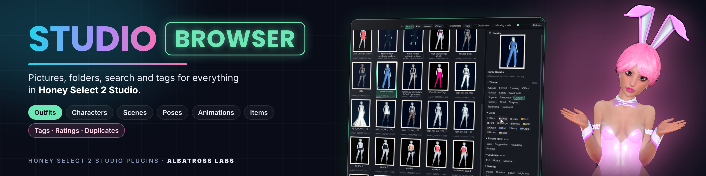
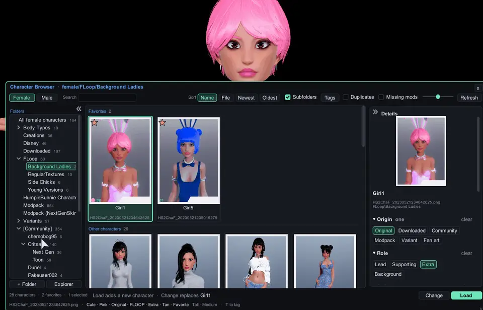
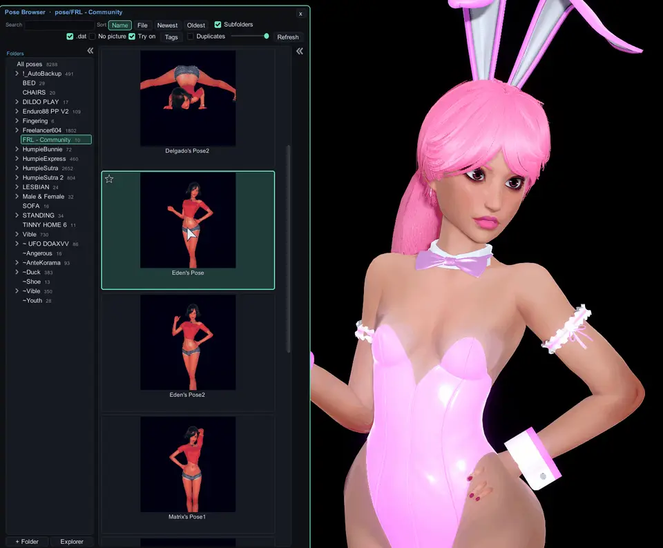

# HS2StudioBrowser

Cohesive method to select, sort, and organize all studio items.

Studio Browser replaces Honey Select 2 Studio's plain text lists with browsers you can actually find things in: pictures, folders, search, favorites and tags. There are seven browsers, one each for outfits, characters, scenes, poses, animations, items and maps. Install only the ones you want.

By **Albatross Labs**.

<!--  -->

## Outfits

Every outfit as a picture, with the folder tree on the left. Load the whole outfit, or only its clothes or only its accessories, onto the selected characters. Outfits that need zipmods you don't have get a red badge naming the missing mods.

## Characters

Your character cards as pictures, split female / male. **Load** adds a character to the scene; **Change** swaps the selected character for this one and keeps their place and pose. Filter by height or bust size, worked out from each card.

## Scenes

Stands in for Studio's Load screen, with every subfolder browsable. Load or Import a scene, filter by who's in it (FF, MMF, 4+...), and scenes go to the Recycle Bin when deleted.

## Poses

Pose pictures in a grid, `.dat` poses included. Use the arrow keys to try each pose on the selected character, and Backspace to put back the pose they had. **Picture** gives a pose a picture of the current view, and **No picture** lists every pose still missing one.

## Animations

Every animation in the game and your zipmods, searchable in one list. Each one shows how long it runs and flags the ones that are really a held pose. Studio's speed, pattern and loop controls are built in, plus a timeline to scrub to any frame.

## Items

Studio's items as a grid of pictures, reusing Quick Access Box's thumbnails and making the missing ones. **Add** puts an item in the scene and **Add inside** puts it in the selected folder. You can give items your own names, and mark the ones you don't want so whole zipmods can be cleared out safely.

## Maps

Studio's maps as pictures, grouped by the base game and each mod author. Load a map, frame a view you like and press **Picture**: it saves exactly what's on screen, with the menus and characters left out. The map's Options and Lights switches are built in, and you can filter for maps with water, lights or optional props.

<!--  -->

## In every browser

- **Tags without typing:** press T for a tag wheel, or click tags in the details panel on the right. Each browser has its own groups, such as color, theme and risqué level for outfits, plus shared **Project**, **Rating** and **Use** groups. Filter by any mix of them.
- **Automatic tags:** worked out from the files themselves, such as which clothing slots an outfit uses, a scene's cast or an animation's length.
- **Favorites with your own folders,** in every browser: star something, then sort your favorites into folders (click a folder in the details panel or drag onto it). Plus search and recently used.
- **Duplicates:** finds copies even when the file names and pictures differ, and keeps your stars and tags on the copy you keep.
- **Rename and move** cards from the browser. The name inside the card changes too, and the rest of the card is left byte for byte.
- **Safe deleting:** cards go to the Recycle Bin, and nothing is ever deleted outright.

<!--  -->

## Plugins it can replace

Studio Browser covers what these plugins do in Studio. You can remove them, or keep them for the parts listed on the right; nothing conflicts if you keep them.

| Plugin | Studio Browser covers | Still worth keeping for |
|---|---|---|
| **Animation Search** | Searching every animation (name, group, category or zipmod) | Nothing in Studio. If installed, the Animations browser reads its full list |
| **Pose Quick Load** | Loading a pose with one click (plus arrow-key try-on and undo) | Nothing in Studio |
| **Studio Character Sort** | Sorting characters by name, file, newest or oldest | Nothing in Studio |
| **Quick Access Box** | Browsing and searching items, favorites, recently used, item pictures | Its pop-up search box. If installed, the Items browser reuses its thumbnails |
| **Browser Folders** | Folders for outfits, characters and scenes in Studio | The character maker and the main game. Studio Browser keeps its scene save folder in step |
| **Studio Misc Search** | Searching maps | Its search boxes for backgrounds and music (BGM, ENV) |
| **Pose Preview** | Pose pictures (and a *No picture* list to make them) | Hover previews of animations, and its hand browser |

## Install

1. Needs HS2 with BepInEx 5 and HS2API, which BetterRepack includes. The Poses browser also needs Pose Tools, which BetterRepack includes too.
2. Unzip into `BepInEx\plugins`. `HS2StudioBrowser.Core.dll` is required; keep whichever browser DLLs you want next to it.
3. Start Studio. Each browser opens in place of Studio's own list, or from its button on the left toolbar.

| Browser | Opens with | Hotkey |
|---|---|---|
| Outfits | character › Costume | Ctrl+Shift+O |
| Characters | Add › Character | Ctrl+Shift+N |
| Scenes | System › Load | Ctrl+Shift+L |
| Poses | character › Kinematics › Pose | Ctrl+Shift+P |
| Animations | Anim › character › Animations | Ctrl+Shift+M |
| Items | Add › Item | Ctrl+Shift+I |
| Maps | Add › Map | Ctrl+Shift+G |

Settings are under F1 › *Studio Browser: …*.

## Modder support

Mod authors can make their items, maps and animations show up with pictures, clean names and tags in Studio Browser by adding a few optional files to their zipmod. Mods without them work exactly the same.

- **Works today:** item pictures in Quick Access Box's thumbnail format, read straight from the zipmod.
- **Planned:** a `studiobrowser/` picture folder in the zipmod, names and tags in `manifest.xml`, creator tags carried in cards, and an **Export for this mod** button that writes the pictures and manifest section for you.

The format and examples are in [docs/MODDERS.md](docs/MODDERS.md).

## More

- [Full guide](docs/GUIDE.md): every button, setting and file, browser by browser.
- [Development](docs/DEVELOPMENT.md): how it works inside, building from source, and the source map.
- [Modder support](docs/MODDERS.md): adding pictures, names and tags to your zipmod.

MIT License.
