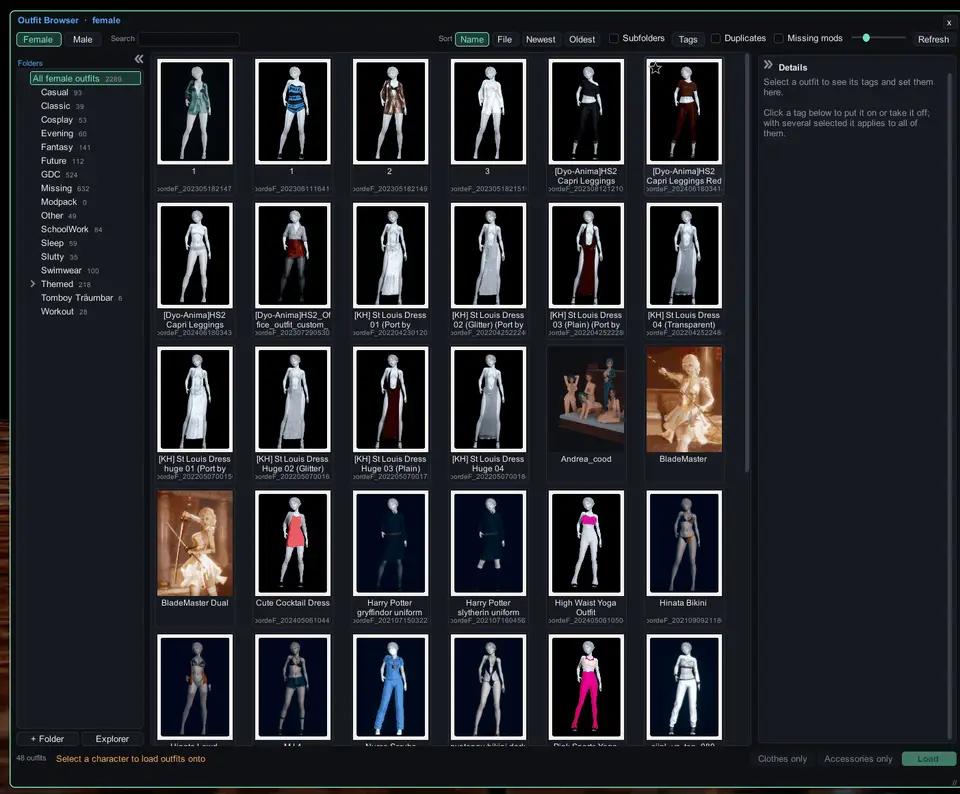
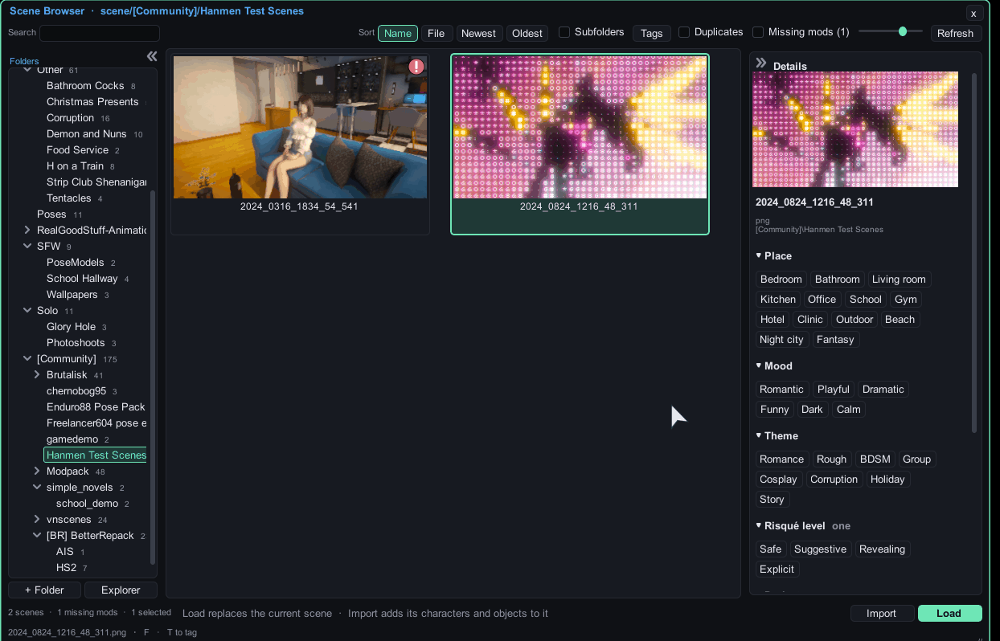
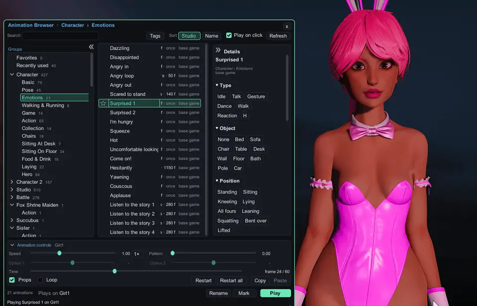
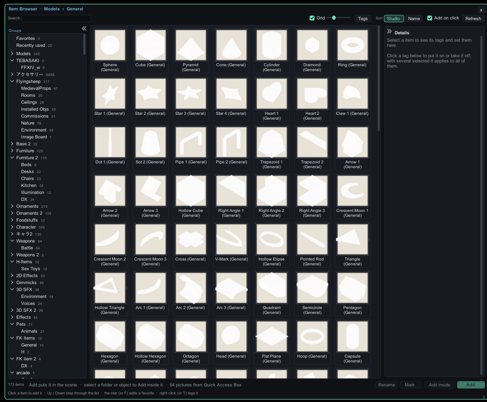

# HS2StudioBrowser

Cohesive method to select, sort, and organize all studio items.

Studio Browser replaces Honey Select 2 Studio's plain text lists with browsers you can actually find things in: pictures, folders, search, favorites and tags. There are six browsers, one each for outfits, characters, scenes, poses, animations and items. Install only the ones you want.

By **Albatross Labs**.

<!--  -->

## Outfits

Every outfit as a picture, with the folder tree on the left. Load the whole outfit, or only its clothes or only its accessories, onto the selected characters. Outfits that need zipmods you don't have get a red badge naming the missing mods.

## Characters

Your character cards as pictures, split female / male. **Load** adds a character to the scene; **Change** swaps the selected character for this one and keeps their place and pose. Filter by height or bust size, worked out from each card.

## Scenes

Stands in for Studio's Load screen, with every subfolder browsable. Load or Import a scene, filter by who's in it (FF, MMF, 4+...), and scenes go to the Recycle Bin when deleted.

## Poses

Pose pictures in a grid, `.dat` poses included. Use the arrow keys to try each pose on the selected character, and Backspace to put back the pose they had. **Picture** gives a pose a picture of the current view, and **No picture** lists every pose still missing one.

## Animations

Every animation in the game and your zipmods, searchable in one list. Each one shows how long it runs and flags the ones that are really a held pose. Studio's speed, pattern and loop controls are built in, plus a timeline to scrub to any frame.

## Items

Studio's items as a grid of pictures, reusing Quick Access Box's thumbnails and making the missing ones. **Add** puts an item in the scene and **Add inside** puts it in the selected folder. You can give items your own names, and mark the ones you don't want so whole zipmods can be cleared out safely.

## In every browser

- **Tags without typing:** press T for a tag wheel, or click tags in the details panel on the right. Each browser has its own groups, such as color, theme and risqué level for outfits, plus shared **Project**, **Rating** and **Use** groups. Filter by any mix of them.
- **Automatic tags:** worked out from the files themselves, such as which clothing slots an outfit uses, a scene's cast or an animation's length.
- **Favorites, search and recently used,** in every browser.
- **Duplicates:** finds copies even when the file names and pictures differ, and keeps your stars and tags on the copy you keep.
- **Rename and move** cards from the browser. The name inside the card changes too, and the rest of the card is left byte for byte.
- **Safe deleting:** cards go to the Recycle Bin, and nothing is ever deleted outright.

<!--  -->

## Install

1. Needs HS2 with BepInEx 5 and HS2API, which BetterRepack includes. The Poses browser also needs Pose Tools, which BetterRepack includes too.
2. Unzip into `BepInEx\plugins`. `HS2StudioBrowser.Core.dll` is required; keep whichever browser DLLs you want next to it.
3. Start Studio. Each browser opens in place of Studio's own list, or from its button on the left toolbar.

| Browser | Opens with | Hotkey |
|---|---|---|
| Outfits | character › Costume | Ctrl+Shift+O |
| Characters | Add › Character | Ctrl+Shift+N |
| Scenes | System › Load | Ctrl+Shift+L |
| Poses | character › Kinematics › Pose | Ctrl+Shift+P |
| Animations | Anim › character › Animations | Ctrl+Shift+M |
| Items | Add › Item | Ctrl+Shift+I |

Settings are under F1 › *Studio Browser: …*.

## More

- [Full guide](docs/GUIDE.md): every button, setting and file, browser by browser.
- [Development](docs/DEVELOPMENT.md): how it works inside, building from source, and the source map.

MIT License.
